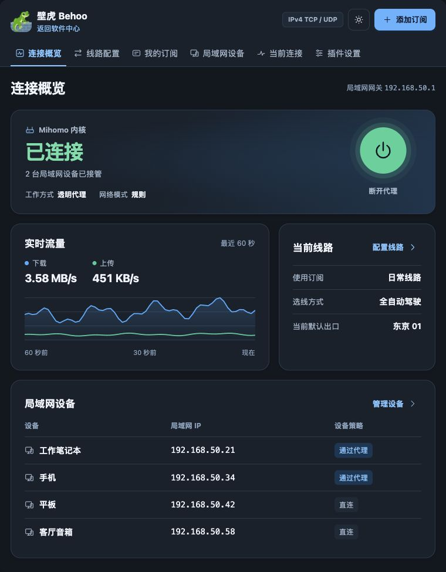
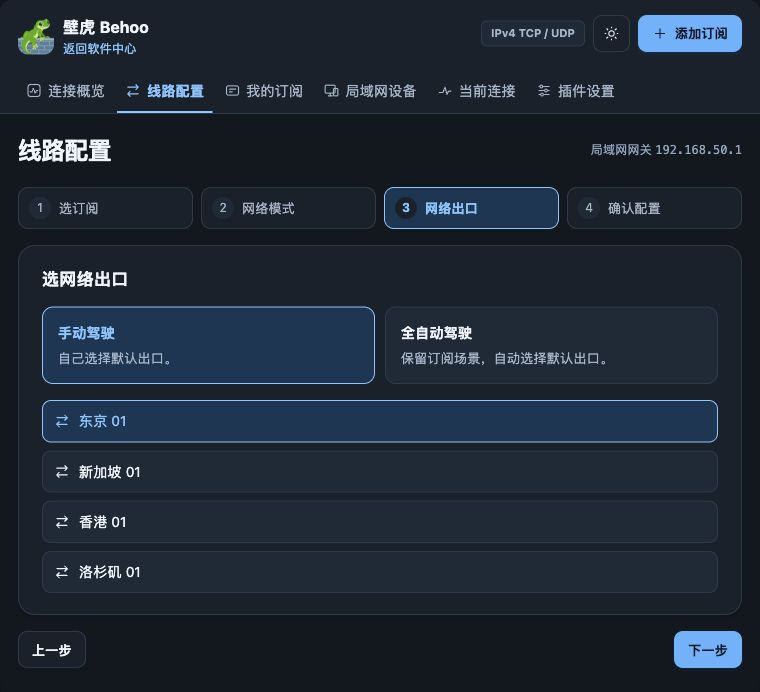
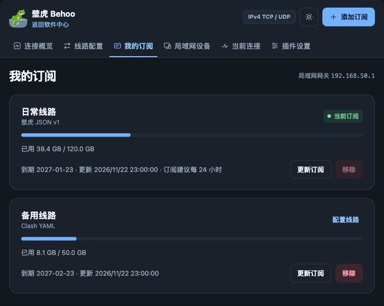
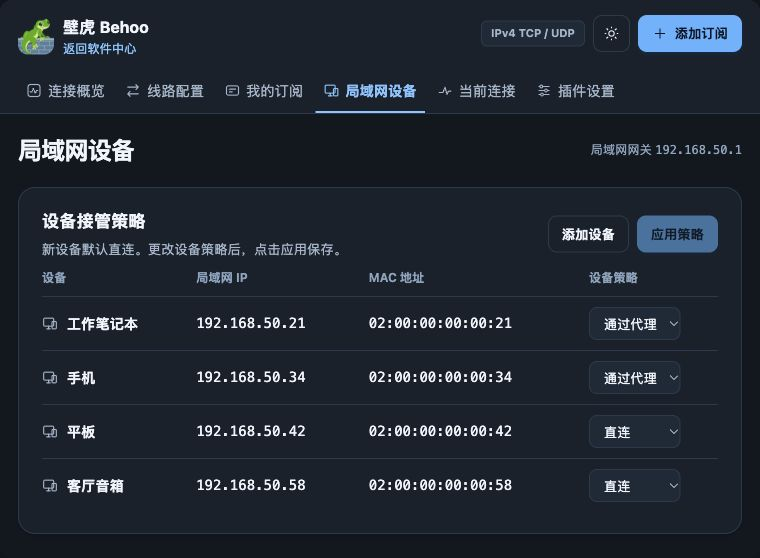
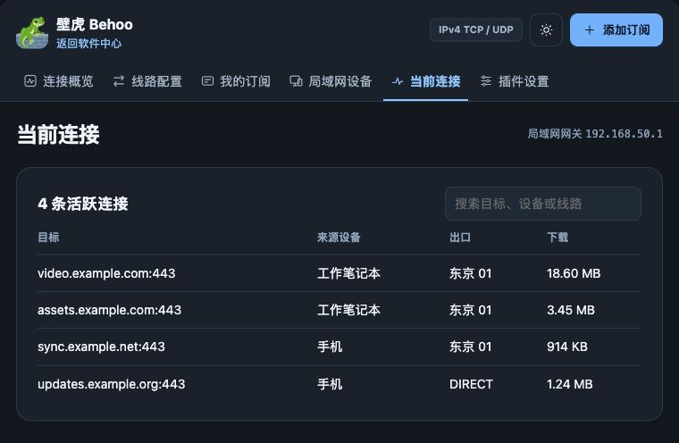
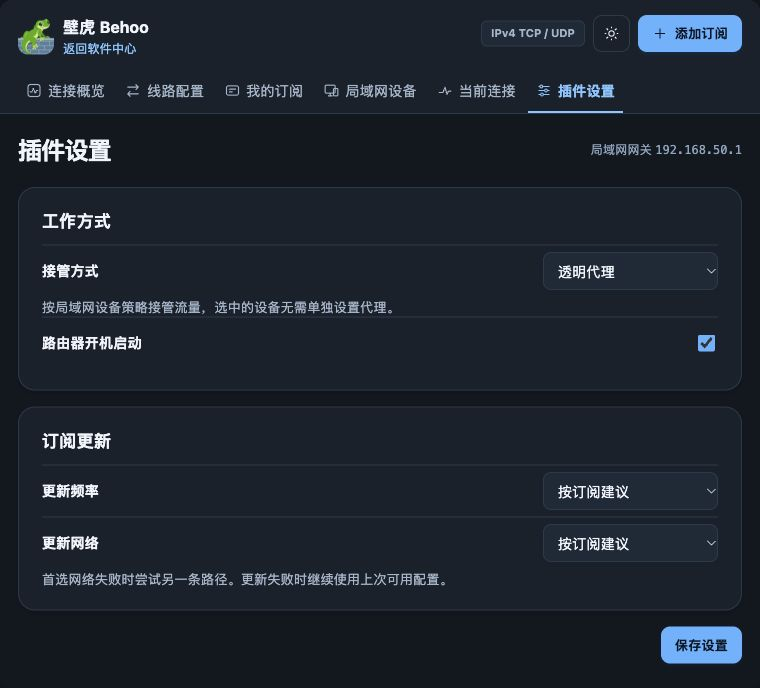

# 壁虎 Behoo · 华硕路由器软件中心插件

壁虎 Behoo 是面向已启用 Koolshare / Koolcenter 软件中心的梅林改版和华硕官改固件的路由器插件。它使用 **Mihomo v1.19.33**，可按局域网设备选择代理或直连，并在路由器后台管理订阅、选择线路和查看流量。

当前离线包版本 **v0.1.12** · [安装包与机型](#安装包与机型) · [安装与使用](#安装与使用) · [界面预览](#界面预览)

## 功能

| 功能 | 支持内容 |
| --- | --- |
| 订阅管理 | 导入 **壁虎 JSON v1** 和 **Clash YAML**。查看订阅用量、到期时间及更新状态，支持手动和定时更新。 |
| XHTTP | 支持订阅中的 **VLESS + XHTTP** 节点，节点参数遵循 [Mihomo 的 XHTTP 配置说明](https://github.com/MetaCubeX/Meta-Docs/blob/main/docs/config/proxies/transport.md)。 |
| 线路配置 | 四步向导依次选择订阅、规则或全局模式、网络出口，再确认配置。可手动选线，也可由 Mihomo 按延迟自动选择出口。 |
| 设备接管 | 按主 LAN 设备的 MAC 地址设置「通过代理」或「直连」。新设备默认直连，可单独添加接管设备。 |
| 代理入口 | 支持透明代理，也可在局域网设备上手动配置 **HTTP / SOCKS5**。 |
| 状态与流量 | 查看连接状态、当前默认出口、最近 60 秒的上下行速率及活跃连接。可按目标、来源设备或出口搜索连接。 |
| 更新与启动 | 支持开机启动。订阅可优先直连或优先代理更新，另一路径可用时自动重试。配置通过 Mihomo 校验后才应用，启动失败时尝试恢复上一份可用配置。 |

壁虎 JSON v1 支持主备入口、节点源及订阅建议的更新频率和网络偏好。Clash YAML 的用量和到期信息来自服务商返回的 `Subscription-Userinfo`。订阅地址保存在路由器上的壁虎私有目录。

## 界面预览

截图取自当前版本的插件页面。连接、流量、订阅与设备均为本地演示数据。

| 连接概览 | 四步线路配置 |
| --- | --- |
|  |  |
| **我的订阅** | **局域网设备** |
|  |  |
| **当前连接** | **插件设置** |
|  |  |

## 安装包与机型

安装包以 **固件平台及用户态位数** 区分。一个版本包含下表七种离线包。机型是对应固件平台的选型示例，安装由检测到的固件环境决定。

| 平台 | 固件用户态及 SoC | 机型示例 | v0.1.12 离线包 |
| --- | --- | --- | --- |
| `arm` | ARMv7 32 位，旧 Broadcom BCM4708 / BCM4709 | RT-AC68U、RT-AC88U、RT-AC3100、RT-AC5300、R6300v2 | `behoo_arm_0.1.12.tar.gz` |
| `hnd` | ARMv7 32 位，Broadcom HND BCM6750 / BCM6755 / BCM6756 | RT-AX56U、RT-AX56U V2、RT-AX58U、RT-AX82U、RT-AX1800、TUF-AX3000、TUF-AX3000 V2、TUF-AX5400、ZenWiFi XT8、ZenWiFi XD4、RAX50、RAX70 | `behoo_hnd_0.1.12.tar.gz` |
| `hnd_v8` | ARM64 64 位，Broadcom HND BCM4906 / BCM4908 / BCM4912 / BCM4916 | RT-AC86U、GT-AC2900、GT-AC5300、RT-AX68U、RT-AX86U、RT-AX86U Pro、RT-AX88U、RT-AX92U、GT-AX11000、GT-AX11000 Pro、GT-AXE11000、GT-AX6000、ZenWiFi Pro XT12、RAX80、RT-BE86U、RT-BE88U、RT-BE96U、GT-BE96、GT-BE98 Pro | `behoo_hnd_v8_0.1.12.tar.gz` |
| `qca` | ARMv7 32 位，Qualcomm IPQ806x / IPQ807x 固件平台 | RT-AX89X | `behoo_qca_0.1.12.tar.gz` |
| `mtk` | ARM64 64 位，MediaTek MT798x / MT799x 固件平台 | TX-AX6000、TUF-AX4200Q、GS7、ZenWiFi BT8P | `behoo_mtk_0.1.12.tar.gz` |
| `ipq32` | ARMv7 32 位，Qualcomm IPQ53xx / IPQ54xx 固件平台 | ZenWiFi BD4 | `behoo_ipq32_0.1.12.tar.gz` |
| `ipq64` | ARM64 64 位，Qualcomm IPQ53xx / IPQ54xx 固件平台 | TUF-BE6500 | `behoo_ipq64_0.1.12.tar.gz` |

特别容易混淆的有 **RT-AC88U 选 `arm`、RT-AX88U 选 `hnd_v8`**，以及 **ZenWiFi BD4 选 `ipq32`、TUF-BE6500 选 `ipq64`**。使用上表对应固件时，同名机型的不同硬件修订和固件版本仍应按安装检测结果选包。

安装脚本读取机型、SoC、内核版本及 BusyBox 或 `/bin/sh` 的 ELF 位数。通过 SSH 核对时可先查看以下信息。固件提供 `od` 时，最后一条命令输出 `1` 表示 32 位用户态，输出 `2` 表示 64 位用户态。`uname -m` 显示内核架构。

```sh
nvram get odmpid
nvram get productid
uname -m
uname -r
od -An -t u1 -j 4 -N 1 /bin/busybox
```

七个平台的 v0.1.12 离线包均已交叉编译并通过 SHA256 校验。机型归类参考 [fancyss 固件矩阵](https://github.com/hq450/fancyss#支持机型固件) 和本项目的 [平台检测脚本](router/platform.sh)，逐款路由器上的安装和透明接管仍需实机验证。

### 获取离线包

- 本地构建后，从 `dist/` 取表中对应的 `.tar.gz`。同目录有每个安装包的 `.sha256` 和合并的 `SHA256SUMS-0.1.12`。
- GitHub Actions 的 [Build Merlin packages](.github/workflows/packages.yml) 工作流生成名为 `behoo-merlin-offline-packages` 的下载产物。打开对应运行记录，从 **Artifacts** 下载并解开外层 ZIP，即可取得各平台离线包。

## 安装与使用

1. 在路由器后台打开已启用的 **Koolshare / Koolcenter 软件中心**。
2. 进入 **离线安装**，上传和固件平台匹配的 `behoo_<平台>_<版本>.tar.gz`，并查看安装日志。
3. 打开 **壁虎 Behoo**，点 **添加订阅**，填入订阅地址。在线路配置里选好模式和出口，点 **应用配置**。
4. 使用透明代理时，在 **局域网设备** 为一台设备选择 **通过代理**并应用。回到 **连接概览** 开启代理，再查看状态和当前连接。
5. 卸载可在软件中心操作。卸载会停止代理、撤销壁虎接管规则与启动钩子，并删除本机壁虎订阅和设置。

### 接管方式

| 工作方式 | 实际行为 |
| --- | --- |
| 透明代理 · IPv4 TCP / UDP | 固件支持 TPROXY 时，接管主 LAN 已选设备的公网 IPv4 TCP 和 UDP。 |
| 透明代理 · IPv4 仅 TCP | TPROXY 探测失败时采用 REDIRECT，接管主 LAN 已选设备的公网 IPv4 TCP。 |
| HTTP / SOCKS5 | 在需要代理的设备上，将代理地址设为路由器 LAN IPv4，端口为 `17990`。 |

透明模式也会处理已选设备发往路由器 IPv4 地址的标准 DNS 请求。局域网和路由器管理流量直连。IPv6 和访客网络沿用路由器原有路由。

### 安装所需空间

以下按 v0.1.12 的实际安装包统计。JFFS 一栏估算正常安装写入的文件大小，升级暂存空间、软件中心预留空间以及订阅数据和规则库另计。

| 平台 | 离线包 | 写入 JFFS | 默认解压到 `/tmp` 的内核 |
| --- | ---: | ---: | ---: |
| `arm` | 15.0 MiB | 18.7 MiB | 33.0 MiB |
| `hnd`、`qca`、`ipq32` | 17.7 MiB | 22.2 MiB | 39.3 MiB |
| `hnd_v8`、`mtk`、`ipq64` | 17.0 MiB | 21.2 MiB | 39.0 MiB |

默认将压缩内核保存在 JFFS，校验或运行时解压到 `/tmp`。空间不足时，可将内核装到允许执行程序的 USB 文件系统。以下以 `hnd_v8` 为例，实际操作时替换挂载点和离线包名。订阅及插件设置存储在软件中心分区。

```sh
mkdir -p /tmp/mnt/USB/behoo-install /tmp/mnt/USB/behoo
tar -xzf /tmp/mnt/USB/behoo_hnd_v8_0.1.12.tar.gz -C /tmp/mnt/USB/behoo-install
BEHOO_STORAGE=/tmp/mnt/USB/behoo /bin/sh /tmp/mnt/USB/behoo-install/behoo/install.sh
```

## 更新记录

| 版本 | 主要变更 |
| --- | --- |
| 0.1.12 | `GeoIP.dat` 缺少 `GEOIP,youtube` 时，使用 [YouTube IP 规则集](https://github.com/blackmatrix7/ios_rule_script/blob/master/rule/Clash/YouTube/YouTube.yaml) 中三个网段。数据库自带条目优先。 |
| 0.1.11 | 区分地理数据库缺少条目与文件无法解析。MetaCubeX 官方 Lite 库缺少条目时尝试完整版。 |
| 0.1.10 | 保留订阅指定的地理规则数据库和模式。配置校验报错显示对应规则或节点编号。 |
| 0.1.9 | 在提交前生成导入任务编号，软件中心回执超时后可查询原任务结果。 |
| 0.1.8 | 添加订阅弹窗内显示导入进度和失败原因。 |
| 0.1.7 | 集成 Merlin 菜单，软件中心优先通过 `POST /_api/` 调用管理脚本。 |
| 0.1.6 | 支持软链接挂载的软件中心目录，离线安装日志显示管理服务启动错误。 |
| 0.1.5 | 创建临时文件时兼容缺少 `mktemp` 的固件。 |
| 0.1.4 | 固定通过 `/bin/sh` 执行平台检测，兼容同名工具。 |
| 0.1.3 | 兼容缺少 `id`、`command -v` 和 `nohup` 的固件。 |

## 自行构建

常规平台使用 Go 1.26.x 等兼容工具链。旧 `arm` 包使用 Go 1.23.x，以兼容老固件内核。构建产物位于 `dist/`。

```sh
# 构建全部七个平台
GO_MODERN=/path/to/go GO_LEGACY=/path/to/go1.23.12 ./build.sh

# 只构建一个平台
./build.sh hnd_v8

# 运行管理服务与内核测试
go test ./...
(cd core && go test -tags no_easytier,no_zerotier ./...)

# 核对所有离线包
(cd dist && shasum -a 256 -c SHA256SUMS-0.1.12)
```

内核入口在 `core/`，依赖版本锁定在 `core/go.mod` 和 `core/go.sum`。内核保留常用代理协议，精简构建省略 EasyTier 和 ZeroTier。参见 [内核许可证](core/LICENSE-Mihomo.txt) 和 [Mihomo v1.19.33 源码](https://github.com/MetaCubeX/mihomo/tree/v1.19.33)。
